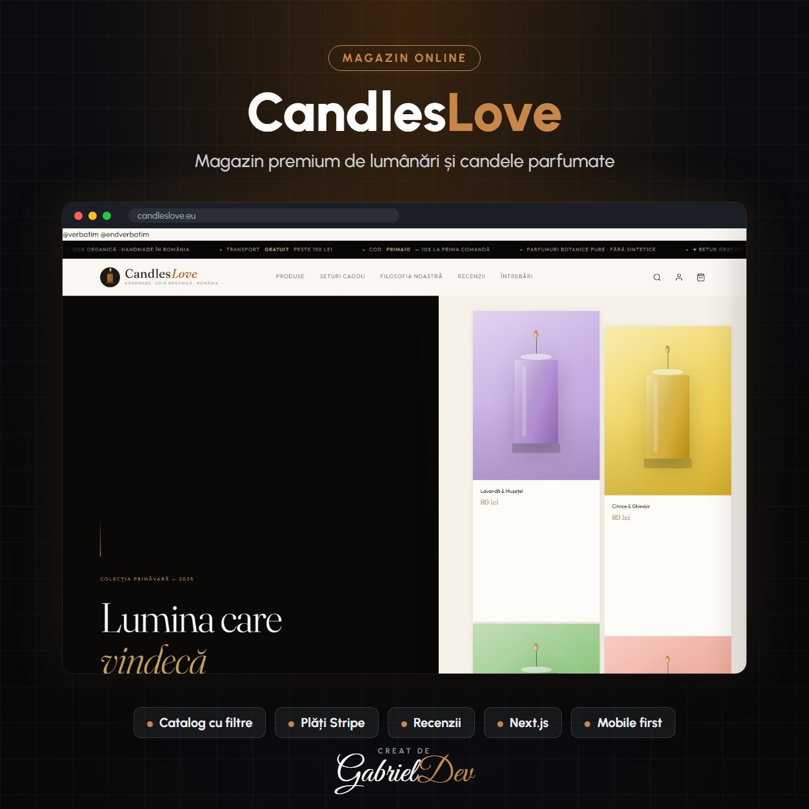

  

<h1 align="center">Magazin online CandlesLove</h1>

Candleslove este un magazin online modern specializat în candele parfumate, lumânări handmade, difuzoare de arome și produse pentru aromaterapie. Proiectul a fost dezvoltat cu scopul de a oferi utilizatorilor o experiență premium, caldă și relaxantă încă din primul contact vizual, punând accent pe designul elegant, navigarea intuitivă și simplitatea procesului de cumpărare.

| | |
|---|---|
| **Client** | Client privat |
| **An** | 2023 |
| **Domeniu** | Backend Development · Frontend Development |
| **Status** | Live — [candleslove.eu](https://candleslove.eu) |
| **Studiu de caz** | [gabrieldev.eu](https://gabrieldev.eu/portofoliu/magazin-online-candleslove) |

---

#### Descriere

CandlesLove este un magazin online modern dedicat candelelor parfumate, lumânărilor artizanale și produselor de aromaterapie. Proiectul a fost construit cu focus pe design elegant, experiență intuitivă și navigare ușoară, astfel încât utilizatorii să poată descoperi, compara și comanda produse într-un mod rapid și plăcut. Atmosfera vizuală a site-ului a fost concepută pentru a transmite căldură, relaxare și eleganța produselor prezentate.

#### Key Features

- Design Premium & Minimalist: Interfață vizuală curată, bazată pe tonuri calde, poze mari și carduri elegante pentru prezentarea produselor.
- Catalog de Produse cu Categorii: Filtrare după aromă, colecție, material (ceară naturală/soia) și intensitate.
- Pagina Individuală de Produs: Include note de parfum, recenzii, ingrediente și sugestii similare.
- Coș de Cumpărături & Checkout: Proces complet de adăugare în coș, vizualizare total și finalizare comandă.
- Sistem Recenzii & Rating: Utilizatorii pot oferi feedback și pot evalua produsele achiziționate.

#### Technologies Used

- Front-End: React / Next.js cu TailwindCSS pentru interfață modernă și responsive.
- Back-End: Node.js & Express pentru API, logica de coș, produse și comenzi.
- Database: MongoDB pentru stocarea flexibilă a produselor, categoriilor și utilizatorilor.
- Auth: Sistem de autentificare JWT + posibil login cu Google OAuth.
- Payments: Stripe pentru procesare plăți online sigură și rapidă.

#### Design Highlights

- Stil Vizual Calm & Elegant: Focus pe simplitate, fotografii mari cu produse în iluminare caldă.
- UX Orientat spre Conversie: Meniuri clare, flow rapid spre checkout, recomandări personalizate.
- Responsivitate Completă: Optimizat pentru desktop, tabletă și mobil.

---

## 🔒 Despre cod

Acesta este un repository de **prezentare**. Codul sursă aparține clientului și nu este public — aici găsești descrierea proiectului, funcționalitățile și tehnologiile folosite.

## 🤝 Ai nevoie de ceva asemănător?

Proiect realizat de **[Gabriel Dev](https://gabrieldev.eu)** — creare site-uri, magazine online și aplicații web personalizate.

- 🌐 [gabrieldev.eu](https://gabrieldev.eu) · [toate proiectele](https://gabrieldev.eu/proiecte)
- ✉️ [contact@gabrieldev.eu](mailto:contact@gabrieldev.eu)
- 📞 [+40 743 543 100](tel:+40743543100)
